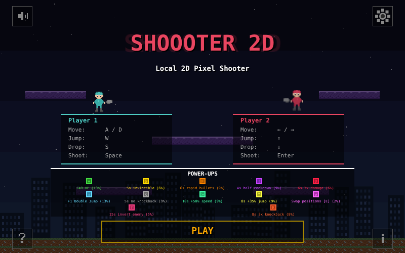

# SHOOOTER 2D

A local multiplayer 2D pixel shooter game built with HTML5 Canvas and vanilla JavaScript. No frameworks, no dependencies - just pure browser fun!



## Play Now

**[Play in your browser!](https://aschenkl.github.io/Shoooter-2D/)**

## Features

- **Local Multiplayer** - Player vs Player or Player vs AI
- **5 Game Modes:**
  - Classic - Reduce enemy HP to 0
  - One Shot - 1 HP, one hit kills!
  - King of the Hill - Hold the glowing zone to score
  - Tag - Avoid being the tagger!
  - Lava Rise - Climb upward as lava rises, last alive wins!
- **15 Power-Ups** (see below)
- **Special Platforms** - Ice (slippery!), Bounce (trampolines!), Breakable, Moving
- **Wind Zones** - Horizontal wind pushes you sideways mid-air
- **Procedural Structures** - Lava Rise generates unique climbing challenges
- **Full Mouse Support** - Click, hover and scroll through all menus; mouse buttons can be bound as controls
- **Fullscreen-Friendly** - The game scales to fill your browser window
- **In-Game HUD** - 3-2-1-FIGHT! countdown, round display, kill feed and active power-up timers
- **Pause Menu** - Resume, adjust volume, open settings or return home
- **Customizable Settings** - HP, gravity, rounds, AI difficulty, power-up frequency, skins, key bindings and more (with tooltips); settings are saved in your browser
- **Character Customization** - Hover over a player on the start screen to change their look
- **Pixel Art Style** - Retro aesthetics with modern gameplay
- **Bilingual** - English & German (Deutsch)

## Power-Ups

| Power-Up | Effect |
|----------|--------|
| Heal | +40 HP |
| Shield | 5s invincible |
| Rapid Bullets | 6s rapid fire |
| Half Cooldown | 4s half shooting cooldown |
| More Damage | 6s 3x damage |
| Double Jump | +1 double jump (stored in inventory) |
| No Knockback | 5s immune to knockback |
| Speed Boost | 10s +50% speed |
| Super Jump | 8s +35% jump height |
| Swap | Swap positions with your enemy (stored, use with the Swap key) |
| Invert | Inverts the enemy's controls for 15s |
| Mega Knockback | 8s 3x knockback |
| Extra Life | +1 life *(Lava Rise only)* |
| Lava Freeze | Stops the lava for 5s *(Lava Rise only)* |
| Platform | Spawn a platform beneath you mid-air with the Drop key (stored) *(Lava Rise only)* |

## Controls

| Action | Player 1 | Player 2 |
|--------|----------|----------|
| Move | A / D | Arrow Left / Right |
| Jump | W | Arrow Up |
| Drop | S | Arrow Down |
| Shoot | Space | Enter |
| Swap (inventory) | E | Right Shift |

Move, jump, drop and shoot can be rebound (including mouse buttons) in the settings.

Press **ESC** during a match to open the pause menu.

## How to Run Locally

1. Clone the repository:
   ```bash
   git clone https://github.com/ASchenkl/Shoooter-2D.git
   cd Shoooter-2D
   ```
2. Start any local web server:
   ```bash
   python3 -m http.server 8080
   ```
3. Open `http://localhost:8080` in your browser.

## AI Simulation

`ai-sim.js` is a standalone Node.js script that pits different AI models against each other in a simplified Classic-mode simulation:

```bash
node ai-sim.js
```

## Tech Stack

- HTML5 Canvas (800x500, scaled to the window)
- Vanilla JavaScript (~8000 lines)
- No external dependencies

## License

Made with fun in mind.
