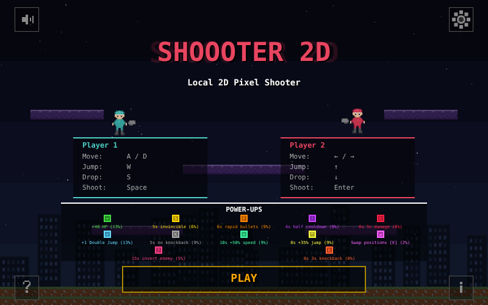

# SHOOOTER 2D

A local multiplayer 2D pixel shooter game built with HTML5 Canvas and vanilla JavaScript. No frameworks, no dependencies - just pure browser fun!



## Play Now

**[Play in your browser!](https://aschenkl.github.io/Shoooter-2D/)**

## Features

- **Local Multiplayer** - Player vs Player or Player vs AI
- **5 Game Modes:**
  - Classic - Reduce enemy HP to 0
  - One Shot - 1 HP, one hit kills!
  - King of the Hill - Hold the glowing zone to score
  - Tag - Avoid being the tagger!
  - Lava Rise - Climb upward as lava rises, last alive wins!
- **15 Power-Ups** (see below)
- **Special Platforms** - Ice (slippery!), Bounce (trampolines!), Breakable, Moving
- **Wind Zones** - Horizontal wind pushes you sideways mid-air
- **Procedural Structures** - Lava Rise generates unique climbing challenges
- **Full Mouse Support** - Click, hover and scroll through all menus; mouse buttons can be bound as controls
- **Fullscreen-Friendly** - The game scales to fill your browser window
- **In-Game HUD** - 3-2-1-FIGHT! countdown, round display, kill feed and active power-up timers
- **Pause Menu** - Resume, adjust volume, open settings or return home
- **Customizable Settings** - HP, gravity, rounds, AI difficulty, power-up frequency, skins, key bindings and more (with tooltips); settings are saved in your browser
- **Character Customization** - Hover over a player on the start screen to change their look
- **Pixel Art Style** - Retro aesthetics with modern gameplay
- **Bilingual** - English & German (Deutsch)

## Power-Ups

| Power-Up | Effect |
|----------|--------|
| Heal | +40 HP |
| Shield | 5s invincible |
| Rapid Bullets | 6s rapid fire |
| Half Cooldown | 4s half shooting cooldown |
| More Damage | 6s 3x damage |
| Double Jump | +1 double jump (stored in inventory) |
| No Knockback | 5s immune to knockback |
| Speed Boost | 10s +50% speed |
| Super Jump | 8s +35% jump height |
| Swap | Swap positions with your enemy (stored, use with the Swap key) |
| Invert | Inverts the enemy's controls for 15s |
| Mega Knockback | 8s 3x knockback |
| Extra Life | +1 life *(Lava Rise only)* |
| Lava Freeze | Stops the lava for 5s *(Lava Rise only)* |
| Platform | Spawn a platform beneath you mid-air with the Drop key (stored) *(Lava Rise only)* |

## Controls

| Action | Player 1 | Player 2 |
|--------|----------|----------|
| Move | A / D | Arrow Left / Right |
| Jump | W | Arrow Up |
| Drop | S | Arrow Down |
| Shoot | Space | Enter |
| Swap (inventory) | E | Right Shift |

Move, jump, drop and shoot can be rebound (including mouse buttons) in the settings.

Press **ESC** during a match to open the pause menu.

## How to Run Locally

1. Clone the repository:
   ```bash
   git clone https://github.com/ASchenkl/Shoooter-2D.git
   cd Shoooter-2D
   ```
2. Start any local web server:
   ```bash
   python3 -m http.server 8080
   ```
3. Open `http://localhost:8080` in your browser.

## AI Opponent

The computer player lives in `ai.js` and plays by the same rules as a human: it only presses keys, so facing follows movement, shots have a cooldown, ammo runs out and inverted controls hit it too. It never gets extra speed or information.

How it works:

- **Navigation** - platforms are nodes of a graph, and every edge is a jump or drop that was simulated frame by frame with the real physics (including moving platforms and bounce pads). Routes are planned with Dijkstra, so the bot only attempts jumps it can actually land - on every map, in every mode.
- **Aiming** - bullets fly horizontally, so the bot knows exactly when a shot can hit. It aims with a difficulty-dependent error and perception lag, leads jumping targets (Hard), never fires backwards while retreating, and stops shooting at a shielded enemy (Medium/Hard).
- **Dodging** - it notices incoming bullets with a reaction delay and only reacts to bullets that would really hit. When there is time it drops through its platform (and is out of the line of fire for good), otherwise it jumps - but not endlessly.
- **One brain per mode** - Classic/One Shot: pick a shooting position on the enemy's height, weigh power-ups and ammo against the fight, back off or jump over a cornering enemy. King of the Hill: route to the hill, trade shots instead of jumping out of the zone, fetch ammo only when it doesn't cost the hill. Tag: as the tagger, chase and shoot (a hit passes the tag); as the runner, pick the platform the tagger needs longest to reach and get out of its line of fire. Lava Rise: a look-ahead jump planner that keeps the bot on screen, avoids dead ends and uses double jumps, swaps and platform charges in emergencies.

| Difficulty | Reaction | Aim error | Dodges | Fire rate | Special |
|------------|----------|-----------|--------|-----------|---------|
| Easy | ~270 ms | large | rarely | 600 ms | hesitates, grabs whatever power-up is close |
| Medium | ~120 ms | medium | half of the time | 450 ms | stop-and-shoot, adapts to inverted controls after 2.5 s |
| Hard | ~50 ms | small | almost always | 300 ms | leads jumping targets, deeper route planning, uses items |

## AI Simulation

`ai-sim.js` runs the **real game** headless in Node (no browser needed) and lets two computer players play against each other, so the numbers say something about the AI people actually play against:

```bash
node ai-sim.js                                   # difficulty ladder in every mode
node ai-sim.js --mode classic --games 100 --p1 easy --p2 hard
node ai-sim.js --mode lava --games 30 --ammo infinite
```

Options: `--mode classic|oneshot|koth|tag|lava|all`, `--games N`, `--p1/--p2 easy|medium|hard`, `--map`, `--ammo limited|infinite`, `--seed`, `--verbose`.

## Tech Stack

- HTML5 Canvas (800x500, scaled to the window)
- Vanilla JavaScript (`game.js` ~6500 lines, `ai.js` ~1500 lines)
- No external dependencies

## License

Made with fun in mind.
